# HD2Lab | Midpoint (PKPilot0002)

When several people meet, the exact middle.
Drop each person's starting point and the app finds the **fairest meeting point for everyone** plus the
**meeting hub** to gather at. By public transport it picks from every metro station, KTX/SRT station and bus
terminal in the country; by car it picks from highway ICs, service areas and large parking hubs.
Once the hub is set, it finds restaurants and cafés around it **without leaving the app** and builds a
first-round + second-round date course.

- Live: <https://hyangdan2.github.io/PKPilot0002/>
- One external API key only (NAVER Maps) · no build · static files only (NAVER Maps Web API v3)

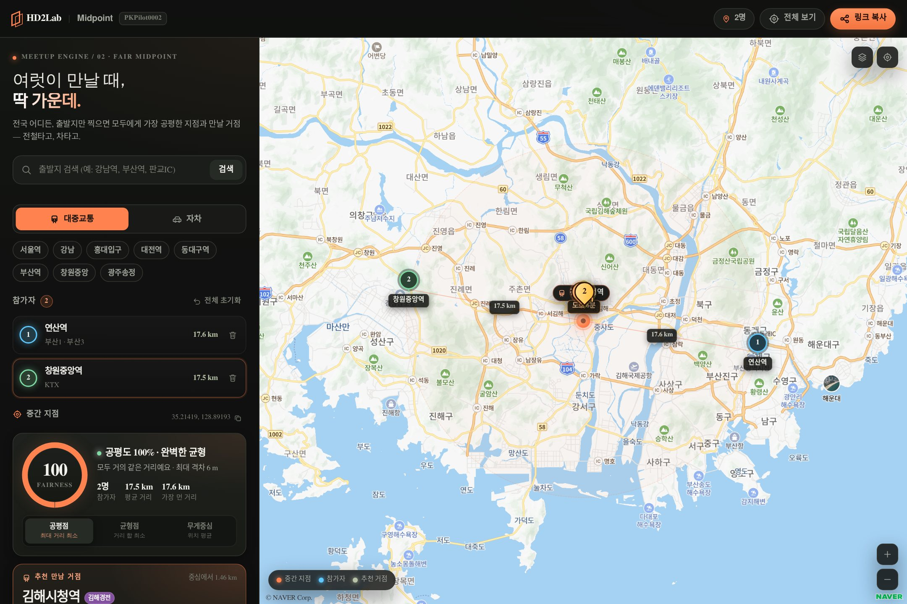

| Date course — Gangnam | Restaurant / café list |
| --- | --- |
| 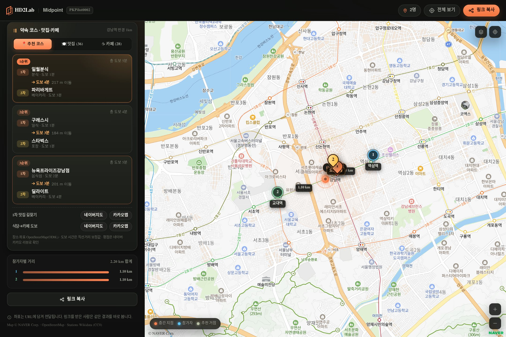 | 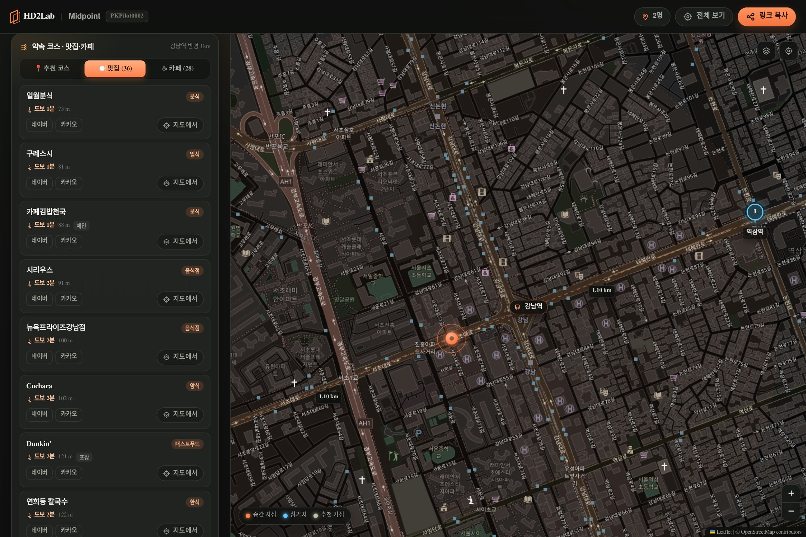 |
| **Seomyeon course** | **Mobile course** |
| 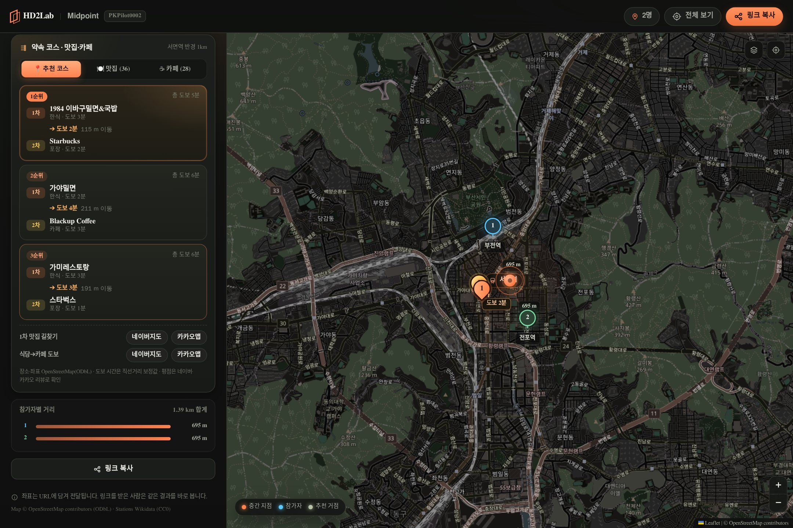 | 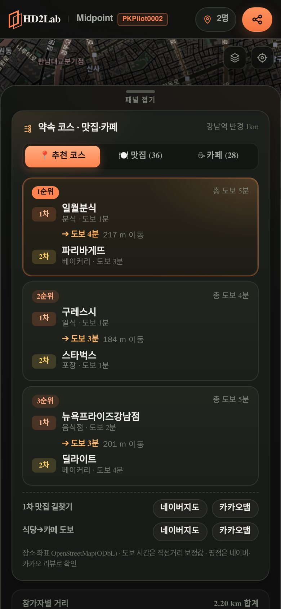 |

| Live in-app discovery (Isu) | Widening the radius while live |
| --- | --- |
| 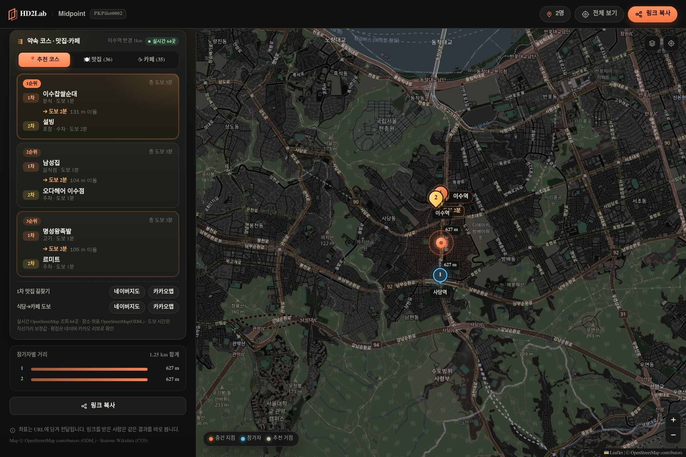 | 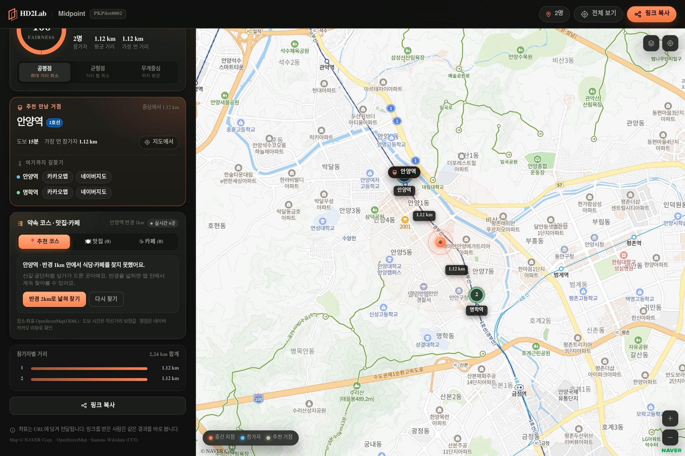 |

| Mobile live discovery | Car mode live discovery |
| --- | --- |
| 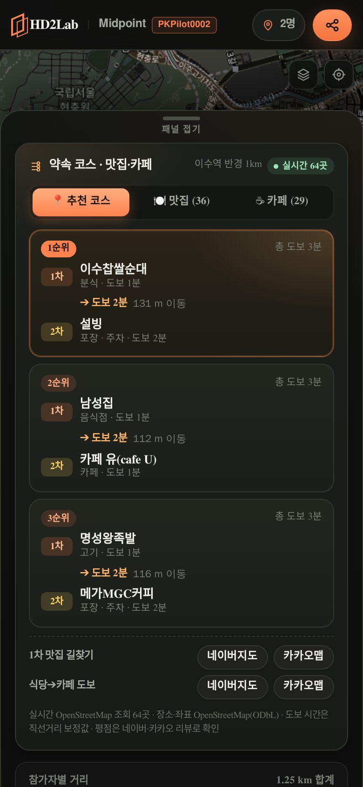 | 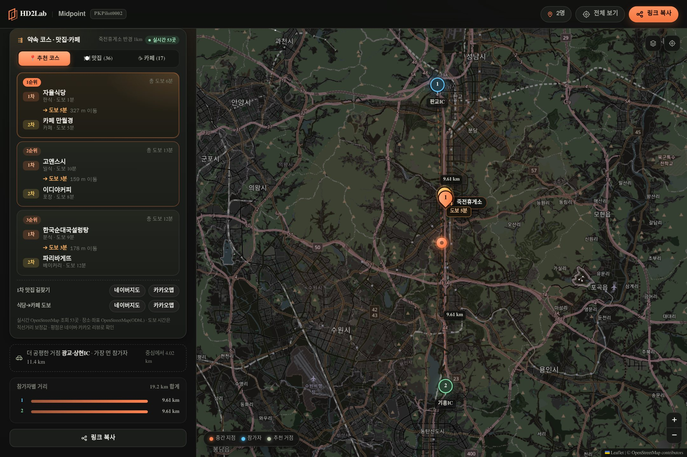 |

| Yeongnam car mode | Long distance (Seoul↔Busan) KTX transfer |
| --- | --- |
| 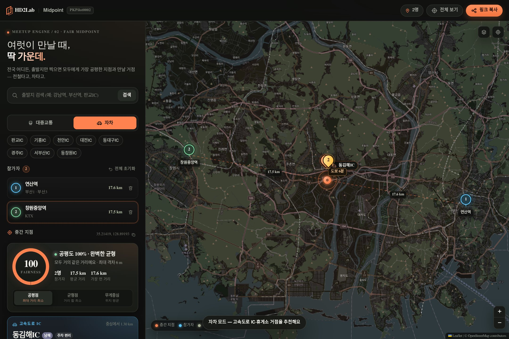 | 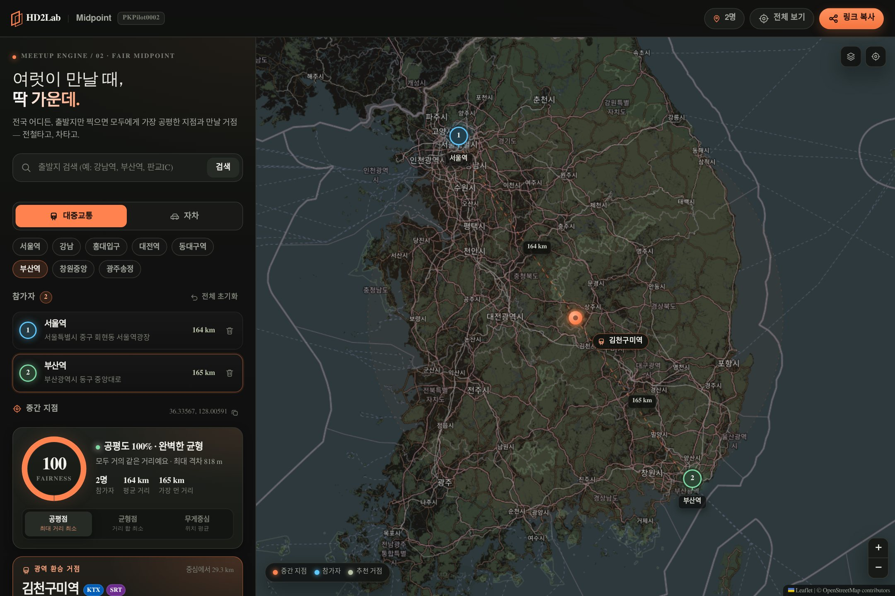 |

## Features

**Starting points**
- Add a participant by clicking the map (Person 1, Person 2 …, each with its own colour marker)
- **Live autocomplete in the search box**: as you type, it suggests from the built-in 957 stations and
  terminals plus 799 ICs, service areas and parking hubs (partial match, Korean initial-consonant search
  such as `ㄱㄴ`, up to 7 results)
  - Tap a result to add it as a starting point; `↑`/`↓` + Enter works too
  - If the built-in data has no match, Enter or the search button falls back to an external Nominatim
    address search
- Quick picks that follow the mode: public transport (Seoul, Gangnam, Hongdae, Daejeon, Dongdaegu, Busan,
  Changwon Jungang, Gwangju Songjeong) or car (Pangyo IC, Giheung IC, Cheonan IC, Daejeon IC, Dongdaegu IC,
  Gyeongju IC, Seobusan IC, Dongchangwon IC)
- Drag a marker to fine-tune, rename inline, delete one, or clear all
- Up to 12 people; two or more and it calculates immediately

**The midpoint engine — three viewpoints**
| Mode | Calculation | Meaning |
| --- | --- | --- |
| **Fair point** (default) | Centre of the minimum enclosing circle (1-center) | Minimises the farthest person's distance — even for everyone |
| Balanced point | Geometric median (Weiszfeld) | Minimises the **sum** of everyone's travel distance |
| Centroid | Spherical centroid (3D vector average) | The average position — the coordinate centre |

- Shown on the map as an accent pulse marker, with a **dashed line and straight-line distance (km)** per
  participant
- A faint circle at the average distance (the fairness radius)
- **Fairness index**: `100 × (1 − (max − min) / (max + min))` — 100% when everyone is equally far, close to
  0% when one person is left out. The value is graded “perfectly balanced / very fair / reasonable /
  slightly skewed / lopsided”.
- A distance bar per participant plus the total
- **0 ms first paint** — the midpoint marker, fairness score, distances and navigation deep links are drawn
  the moment the starting points are set; addresses (Nominatim reverse geocoding) and nearby restaurants are
  filled in the background. Reverse geocoding runs through a 1-second queue with a 7-day browser cache, so
  it never blocks the screen

**Recommended meeting hubs — travel-mode toggle**
- **🚇 Public transport**: nationwide urban rail (604 in the capital area plus Busan, Daegu, Daejeon and
  Gwangju) + 50 KTX/SRT stations + 26 express/intercity bus terminals, shown with line badges
- **🚗 Car**: 586 highway ICs + 205 service areas and meeting plazas + 8 large parking complexes, shown with
  a highway badge and a “parking available” badge
  - A one-click **[🎯 exact centre | 🛣️ IC · service area]** toggle at the top of the result card — city and
    short trips use the centre coordinate (parking within 1–2.5 km), long highway trips use ICs and service
    areas. The default follows the largest participant distance: under 50 km centre, over 50 km IC/service
    area
- When the farthest pair is **50 km or more** apart, transfer hubs get a weight bonus — KTX/SRT stations and
  complex transfer centres for transit, service areas and ICs for cars — so a Seoul↔Busan meeting snaps to a
  wide-area hub that is easy to reach rather than “some station in the middle”
- A fairer alternative candidate is offered alongside (one that shortens the farthest person's trip)

**Real navigation deep links**
- A directions button per participant on the recommended hub card: Kakao Map · Naver Map (T map as well in
  car mode)
  - Transit: Kakao Map directions · Naver Map public-transport route
  - Car: Kakao Navi · Naver Map driving route · T map app scheme
- One tap to see how many minutes each person needs by train or by car

**🍽️ Nearby restaurants · cafés · 1st + 2nd round course — anywhere in the country, inside the app**
- **30 major hubs are instant from a built-in snapshot** (Gangnam, Hongdae, Sinchon, Jongno, Seoul Station,
  Yongsan, Wangsimni, Seongsu, Jamsil, Yeongdeungpo, Sadang, Express Bus Terminal, Sillim, Hyehwa,
  Gwanghwamun, Nowon, Pangyo, Suwon; Busan Seomyeon, Haeundae, Busan Station; Daegu Dongseongno,
  Dongdaegu; Daejeon Dunsan, Daejeon Station; Gwangju Sangmu, Gwangju Songjeong; Changwon Sangnam,
  Changwon Jungang; Gimhae City Hall)
- Every other **station, terminal, IC, service area or arbitrary midpoint among the ~900 remaining** is
  **queried live inside the app** — the browser calls the OpenStreetMap Overpass API (four mirrors) directly
  for named restaurants, cafés and bakeries within 1 km, and falls back to the OSM map API (bbox) when the
  Overpass queue is busy. The same session and coordinate are memory-cached, and results from a previous
  visit stay in browser storage for 30 minutes and render instantly
  - While loading, a `🔄 finding nearby places…` skeleton keeps the screen responsive (typically 2–6 s)
  - If nothing is found within 1 km, **widen to 2 km then 3 km**, and **retry** on failure — all inside the app
- Sub-tabs at the bottom of the result card: **[📍 Suggested course | 🍽️ Restaurants (N) | ☕ Cafés (N)]**
- **Suggested course card** — `1st: {restaurant} ({category}, N min walk)` ➔ `M min walk (D m)` ➔
  `2nd: {café} ({feature}, N min walk)`
  - The first stop is a restaurant near the hub; the second is a café **2–5 minutes on foot (100–350 m)**
    from that restaurant. Outdoor seating, dessert and bakery cafés score higher, chains lower
  - Three non-overlapping courses are suggested (widening to 80–600 m if the ideal band is short)
  - One tap for **restaurant directions** and **restaurant ➔ café walking directions** (Naver Map `/walk`,
    Kakao Map `by=FOOT`)
- **Restaurant / café list** — category badge (Korean, Japanese, Chinese, Western, meat, chicken, snacks,
  seafood, Asian, bakery, dessert, café), walking minutes and distance, feature tags (outdoor seating, takeaway,
  parking, accessible, chain), a **★ Naver rating** and **Kakao review** badge per card (linking straight to
  that place), and a **show on map** button
- **Sort toggle [Recommended | Nearest]** — recommended puts verified built-in POIs, parking and outdoor
  seating first; nearest is plain distance from the hub
- **Map visualisation** — with a course selected, `① restaurant` (accent pin) and `② café` (amber pin) plus a
  **dashed polyline** hub ➔ restaurant ➔ café with walking-minute labels per leg; clicking a pin opens a
  popup with name, category and review link
- In car mode places tagged “parking” are sorted first
- Every “look it up on Naver/Kakao Map” notice and external browsing link was **removed** — discovery ends
  inside the app

**Sharing and responsive layout**
- State is encoded in the URL: `?p=37.5665,126.978|37.4979,127.0276&n=Jaehyuk~Minji&m=centroid&t=car`
  (coordinates to 5 decimals ≈ 1 m, `n` only when names were changed, `m` only when not the default `fair`,
  `t` only in car mode)
- Whoever opens the link sees the same result and mode. The address is kept current with
  `history.replaceState`
- Desktop (1440px) left panel / mobile (390px) bottom **three-stage snap sheet** — mini 134px · half 48dvh ·
  full 80dvh
  - It opens at half once the calculation finishes so more than half the map stays visible, and shrinks to
    mini when you touch the map
  - Drag the handle or tap it (mini → half → full), or use the [mini · half · full] buttons next to it
- Mobile Safari handling: 16px inputs (no forced zoom on focus), page zoom and double-tap zoom disabled
  (`user-scalable=no` plus `gesturestart`/double-tap guards), while map pinch-zoom is handled by the Naver
  Maps engine itself

**Branding · share card · HD2Lab portal menu**
- The standard HD2Lab favicon set (`favicon.ico`, `favicon.svg`, `favicon-32x32.png`,
  `apple-touch-icon.png`), PWA manifest and icons (`HD2Lab Midpoint`, theme `#FAFAFD`)
- KakaoTalk/SNS share card: a 1200×630 `og-image.png` (Soft Iris light with the violet dual-skew mark,
  `HD2Lab | Midpoint`, “when several meet, the exact middle”, a mini map and hub tiles) plus Open Graph and
  Twitter `summary_large_image` tags
- Soft Iris light by default and Navy & Lavender dark through the shared 44px floating toggle at the bottom
  right (`localStorage['hd2-theme']`, applied before the first paint); Naver map tiles keep their own colour
- Header `…` button → HD2Lab portal dropdown: **Web-HQ** · **ApplicationHub** · **GameHub** ·
  **TechnicalHub** (opens in a new tab so the app state survives; closes on outside click and Esc;
  arrow/Home/End keys move; `aria-expanded` stays in sync)

## File structure

```
PKPilot0002/
├── index.html            markup + icon sprite + OG/favicon meta + theme pre-paint
├── style.css             Soft Iris / Navy & Lavender tokens · map/panel/sheet layout · portal dropdown
├── app.js                Naver map · participants · mode toggle · result UI · portal menu
├── manifest.json         PWA manifest (HD2Lab Midpoint)
├── favicon.ico · favicon.svg · favicon-32x32.png · apple-touch-icon.png · icon-192.png · icon-512.png
├── og-image.png          1200×630 share card (social-preview.png is the same image)
├── assets/               shared hd2-theme.css / hd2-theme.js (floating light/dark toggle)
├── js/
│   ├── core.js           pure calculations (distance, midpoint, fairness, URL, hub ranking, nearby places, courses) — no DOM
│   ├── stations.js       nationwide metro · KTX/SRT · terminal snapshot, 957 places (generated)
│   ├── driving_spots.js  nationwide highway IC · service area · parking snapshot, 799 places (generated)
│   ├── places.js         1,435 restaurants and cafés around 30 meeting hubs (generated · OSM ODbL)
│   ├── live_places.js    live nearby search for any coordinate (Overpass mirrors → OSM map API fallback · session cache)
│   ├── directions.js     Kakao/Naver/T map directions and walking deep links · map search links
│   └── landmarks.js      9 meeting-hub landmarks (verified with Nominatim)
├── tools/
│   ├── generate_brand_assets.py  favicon set and OG image generator (Pillow + cairosvg)
│   ├── build_network.py          stations.js / driving_spots.js generator (Wikidata + OSM Overpass)
│   ├── build_places.py           places.js generator (OSM Overpass — name, coordinates, opening tags, parking)
│   ├── build_stations.py         (legacy capital-area-only generator, superseded by build_network.py)
│   └── data/                     hub definitions (hubs.json), place snapshots (places.json), KTX/terminal coordinates
├── tests/
│   ├── run_tests.py      unit test runner (Playwright + http.server)
│   ├── unit/             harness and 146 cases (core + places + live_places)
│   └── visual/
│       ├── capture.py            screen checks + screenshots (base, mode toggle, Yeongnam, long distance, course, live in-app discovery, fallback)
│       └── portal_menu_check.py  header `…` portal dropdown checks (desktop/mobile open, close, links, order)
└── docs/screenshots/     desktop and mobile screenshots
```

## Data sources and refresh

- Metro station coordinates and lines: Wikidata (CC0)
- Highway ICs, service areas and road names: OpenStreetMap (ODbL)
- Restaurant and café POIs: OpenStreetMap Overpass API (ODbL) — named `restaurant`, `cafe`, `fast_food`,
  `bakery`, `ice_cream` and `shop=bakery|coffee|dessert` within 800 m, tagged “parking” when a car park
  (`amenity=parking`) is within 150 m
- Live restaurant search: the browser calls the OpenStreetMap Overpass API mirrors
  (`overpass-api.de` → `lz4` → `kumi` → `private.coffee`) in a staggered parallel burst and falls back to
  `api.openstreetmap.org/api/0.6/map.json` (bbox) if all are busy. 1 km radius, named restaurants, cafés and
  bakeries only, with a session memory cache (`Map`) to avoid repeat requests. It applies the same
  classification and clean-up rules as the snapshot
- KTX/SRT stations, bus terminals and large parking hubs: `tools/data/*.json` (checked by hand)

```sh
python3 tools/build_network.py            # reuse cache
python3 tools/build_network.py --refresh  # download from the sources again
python3 tools/build_places.py             # collect restaurants and cafés (reuse cache)
python3 tools/build_places.py --all       # collect the remaining hubs in one Overpass request
python3 tools/build_places.py --emit-only # regenerate js/places.js from the cache only
```

> OSM has no ratings. So “best restaurant” ranking is really distance from the hub (walking minutes), and
> ratings and reviews are handed off to each place's Naver/Kakao Map link.
> Regional hubs with few OSM entries are filled by the live query, and if it is still empty the radius is
> widened and searched again.

## Run locally

```sh
cd PKPilot0002
python3 -m http.server 8080
# http://localhost:8080/
```

It uses ES modules, so opening `file://` will not work; a static server is required.

## Tests

```sh
python3 tests/run_tests.py            # 146 unit tests
python3 tests/visual/capture.py --check   # Chromium screen checks
python3 tests/visual/capture.py       # checks + refresh screenshots
python3 tests/visual/portal_menu_check.py --check   # header `…` portal dropdown
python3 tools/generate_brand_assets.py             # regenerate favicons and the OG image
```

- Unit tests: Haversine, spherical centroid, Weiszfeld and minimum enclosing circle, fairness, coordinate
  normalisation, URL encode/parse (bad coordinates, too many people, hash, full URL), station and landmark
  ranking, search autocomplete (exact, partial, initial consonant, landmark), display formatting,
  **hub-to-result matching, radius/kind filters and parking priority, course pairing (100–350 m walk, no
  duplicates, total), search and walking deep links, POI data integrity (800 m radius, coordinates, links)**,
  **live POI parsing (category, name clean-up, distance, walking time, parking, de-duplication, cap), Overpass
  query and bbox, built-in + live merge, course built from live POIs only, mirror fallback, timeout and
  session cache**
- Screen checks: map tile load, pin and marker counts, result card, URL state, share-link round trip, mode
  switch, delete/clear, mobile sheet collapse and expand,
  **Gangnam, Hongdae, Seomyeon and Gimhae course cards and tab switching, map ①/② markers and polyline,
  live in-app discovery at non-hub hubs (Isu, Uijeongbu, Cheonan, Gumi) with no external links exposed,
  skeleton → widen to 2 km → retry on empty and failed mock responses, mobile horizontal overflow**
- Uses Playwright (Chromium) only, no Node.js. `pip install playwright && playwright install chromium`.
- NAVER Maps only renders on a domain registered in the NCP console. Locally (`http://127.0.0.1`) the map is
  blocked with 401, so screen checks run against the deployment:
  `python3 tests/visual/capture.py --base https://hyangdan2.github.io/PKPilot0002/`

## Data and tiles

| Item | Source | Note |
| --- | --- | --- |
| Map | NAVER Maps Web API v3 (`ncpKeyId`) | Zoom, pan and map-type (normal/satellite) controls are drawn by the app; tiles, logo and copyright are drawn by Naver |
| Geocoding | Nominatim (search / reverse) | Queued at one request per second per the public instance policy, with a result cache |
| Station coordinates | Wikidata (CC0) | Regenerated by `tools/build_network.py` |
| Restaurant and café POIs | OpenStreetMap Overpass (ODbL) | `tools/build_places.py` — 800 m around 30 hubs, 1,435 places, plus the browser's live query. No ratings, so Naver/Kakao review links |
| Landmarks | OpenStreetMap Nominatim | `js/landmarks.js` — used alongside the recommendation candidates |

> The map engine is **NAVER Maps Web API v3** (NCP Web Dynamic Map). The key sits in the `index.html` script
> URL (`ncpKeyId=…`), and for it to work `https://hyangdan2.github.io` must be registered as a **Web service
> URL** for that application in the [NAVER Cloud Platform console](https://console.ncloud.com/maps). An
> unregistered origin (for example a local `http://127.0.0.1:8080`) is blocked with 401, so register
> `http://localhost` as well if you want the map locally. Map type is a normal/satellite toggle; the dark CSS
> filter from the OSM era (`invert + hue-rotate`) was removed because it degraded resolution and shifted colours.

## Limits

- A network connection is needed for the map and addresses. There is no offline cache.
- The public Nominatim instance is called at roughly one request per second. Heavy use needs its own proxy.
- Distances are great-circle, and walking time is an estimate at 4.5 km/h. Real routes and travel times are
  not modelled.
- Station ranking is nearest-coordinate based, so exits and transfer walks are not considered.
- Restaurant and café lists only include places named in OSM. Unlisted places are not caught by the live
  query either, and opening hours and ratings must be checked on the map reviews.
- The live query uses public Overpass and OSM map APIs, so a busy server can add a few seconds or fail
  (four mirrors plus the OSM map API fallback, and the on-screen retry button). A coordinate fetched once is
  cached for the session.
- Course walking distances are the straight-line distance between two points with a 1.25× correction. Real
  footpaths and crossings are not modelled.

## Browsers

Current Chromium, Safari and Firefox. It uses ES modules, `dvh` units and `color-mix()` (iOS 16.4+ /
Safari 16.4+).
